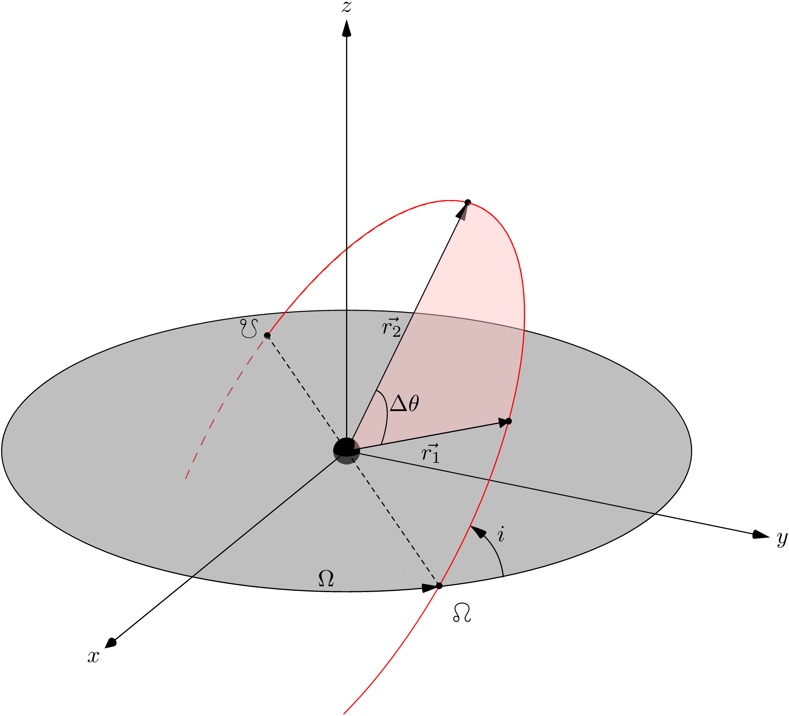

lamberthub
##########

``lamberthub`` provides a common Python interface to Lambert's problem
algorithms. Use it to compare solver behavior or compute transfer velocities
for single-revolution and multi-revolution trajectories.

   Lambert's problem geometry.

.. toctree::
   :hidden:
   :maxdepth: 3

   getting-started
   user-guide
   api-reference
   examples
   changelog
